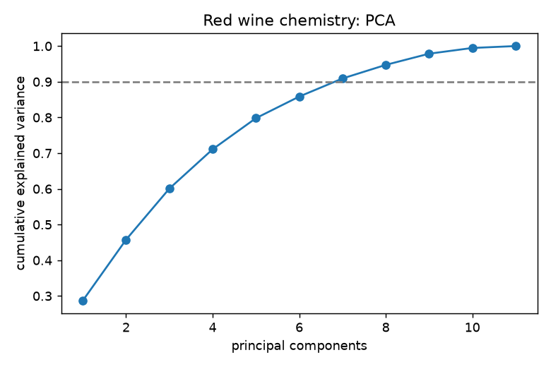
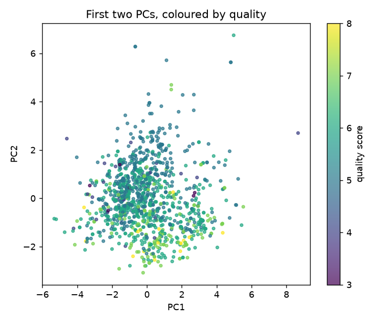

# Wine Quality from Chemistry


**Problem:** 1,143 red vinho verde wines come with 11 lab measurements and a sensory quality score (3 to 8) from human tasters. **How much of a wine's quality can be explained by its chemistry?**

**Answer:** some, but far from all. On unique wines the best model reaches 61% accuracy against 43% for always guessing the most common score. Quality is only partly a function of these 11 numbers.

## 1. What shape does the chemistry have? (PCA)

PCA on the 11 standardised measurements:

- Seven components are needed to explain 90% of the variance; the first two explain only 46%. There is no small set of directions, so the chemistry is genuinely about 7-dimensional.
- PC1 is "acidity and density" (fixed acidity, citric acid, pH, density). PC2 is "sulfur dioxide" (total and free SO2).



Coloured by quality, the first two components show no clean separation:



## 2. How well do models predict quality?

5-fold stratified cross-validation, accuracy. Scaling and PCA are fitted inside each fold. The file contains 125 exact duplicate rows (11%), which can sit in both training and test folds and flatter models that memorise, so the headline numbers use the 1,018 unique rows; the all-rows numbers are shown for comparison.

| Model | Accuracy, unique rows | Accuracy, all rows |
|---|---|---|
| Always guess the most common score (5) | 0.425 | 0.423 |
| Logistic regression on 2 PCs | 0.527 | 0.514 |
| Logistic regression on 7 PCs | 0.586 | 0.584 |
| Logistic regression on all 11 features | 0.595 | 0.601 |
| Random forest on all 11 features | **0.608** | 0.667 |

Full table with standard deviations: [`results/model_comparison.csv`](results/model_comparison.csv).

**What this shows**
- The usual 2D PCA plot, coloured by quality, hides most of the signal: two components give 53% against a 43% baseline.
- Seven components keep almost all of the linear signal (0.586 vs 0.595 for all features).
- The random forest looks clearly best on all rows (0.667) but that lead shrinks to 0.608 once duplicates are removed: it was partly remembering repeated wines. Without the duplicates, a non-linear model adds only about 1 point over logistic regression.
- Quality is partly a human judgement; the chemistry sets a ceiling well under what a perfect predictor would get.

## Limitations

- One region and one wine type (red vinho verde), 1,018 unique wines. Quality classes 3 and 8 have 6 and 16 wines, too few to judge.
- Accuracy on an imbalanced, ordered target (3 to 8) ignores that predicting 5 for a 6 is a smaller error than predicting 3. An ordinal metric or regression would be a natural next step.
- No hyperparameter tuning; the models are defaults, so the gap between them is indicative only.
- Standard deviations across folds are 1-3 points, so the 0.595 vs 0.608 difference is within noise.

## Reproduce

```bash
python -m venv .venv && source .venv/bin/activate   # Windows: .venv\Scripts\activate
pip install -r requirements.txt
python run_analysis.py      # regenerates everything in results/
pytest                      # 7 tests
```

## Layout

```
quality/        data loading, PCA helpers, cross-validated models
run_analysis.py reproduces all tables and figures
tests/          unit tests
data/           wine_quality_red.csv (red vinho verde, with quality)
results/        figures and CSVs used in this README
```

## History

This repo replaces the earlier method-centred repo `DimReduction_PCA`, which only plotted PCA on this dataset.
